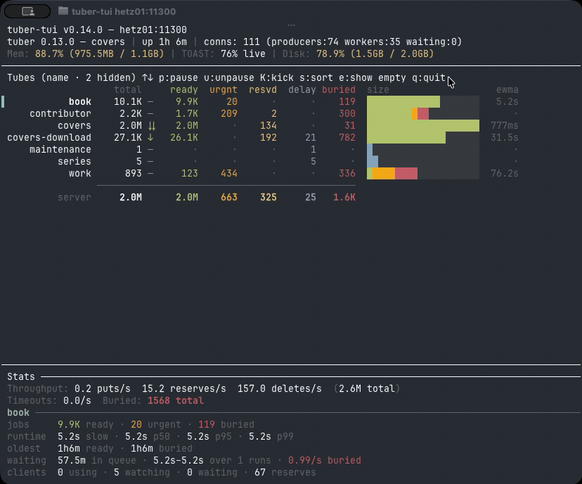
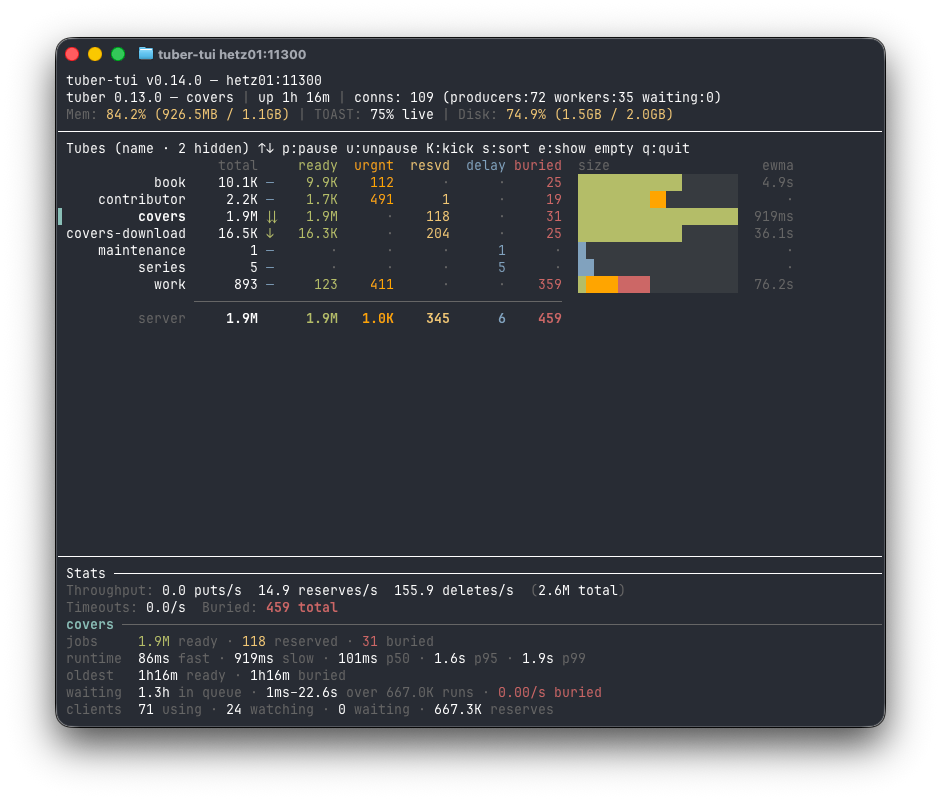
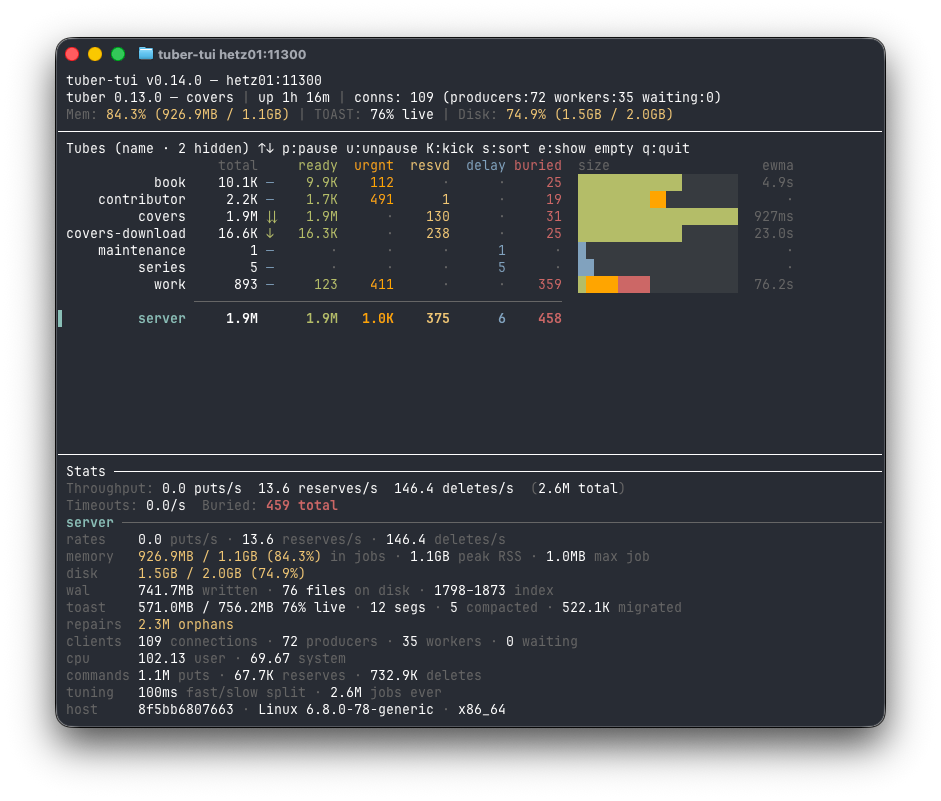

# tuber-rs

Rust client tools for [tuber](https://github.com/tuberq/tuber), a fast work queue server (beanstalkd-compatible).

This workspace contains three crates:

- **tuber-cli** — command-line client with JSON output, designed for scripting and AI agents
- **tuber-tui** — real-time terminal dashboard for monitoring queues
- **tuber-lib** — async client library: the protocol, tuber's extensions, and typed errors

## tuber-cli

An agent-friendly CLI for interacting with tuber/beanstalkd queues. Outputs JSON by default.

### Install

```
brew install tuberq/tuber/tuber-cli
```

Or build from source:

```
cargo install --path tuber-cli
```

### Usage

```bash
# Server stats
tuber-cli stats

# List all tubes
tuber-cli list-tubes

# Tube stats
tuber-cli stats-tube emails

# Put a job
tuber-cli put --tube emails "send user@example.com"

# Put from stdin
echo '{"user": "alice"}' | tuber-cli put --tube notifications

# A body is bytes, so a file needn't be text
tuber-cli put --tube thumbs < photo.jpg

# Tuber extensions: idempotent put, job groups, fan-in, concurrency limits
tuber-cli put --tube emails --idempotent welcome-42 "send welcome"
tuber-cli put --tube work --group batch-1 "shard 1"
tuber-cli put --tube work --after batch-1 "cleanup"
tuber-cli put --tube work --concurrency user-42 "resize avatar"
tuber-cli put --tube work --concurrency user-42:3 "resize avatar"   # up to 3 at once

# Reserve a job
tuber-cli reserve --timeout 5

# Delete a job
tuber-cli delete 42

# Kick buried jobs (all, or one by ID)
tuber-cli kick 10 --tube emails
tuber-cli kick-job 42

# Peek at a job
tuber-cli peek 42

# Drain mode: reject new puts, let in-flight work finish
tuber-cli drain
tuber-cli undrain

# Recurring schedules (tuber only): inspect them...
tuber-cli list-schedules --owner splat
tuber-cli stats-schedule splat rollup

# ...and replace an owner's whole set from a JSON file (- for stdin)
tuber-cli schedule-sync splat schedule.json

# Text output instead of JSON
tuber-cli stats --format text
```

Note that a reservation belongs to the connection that made it, and each
`tuber-cli` run is a new connection. The reservation is released the moment
the process exits, which is why there is no `tuber-cli bury`, `release` or
`touch` — nothing can follow `reserve` to finish the job. Use
[tuber-lib](#tuber-lib) (or one `nc` session) to reserve and finish a job
together; see `skill/SKILL.md`.

A job body that is UTF-8 comes out as `"body"`; one that isn't comes out
base64-encoded as `"body_base64"`, since a JSON string can't hold arbitrary
bytes.

Idempotency keys, group names and concurrency keys take letters, digits and
`- + / ; . $ _ ( )`. A colon is refused rather than sent, because tuber would
read `idp:series:123` as key `series` with a 123-second TTL: give a TTL with
`--idempotent-ttl`, and a concurrency limit as `--concurrency key:N`.

A put whose `--idempotent` key matches a buried job still exits 0 (the key did
its job), but warns on stderr: nothing was queued, and nothing runs until that
job is kicked, so a put from cron that keeps hitting it would otherwise drop
its work without a word.

### Errors and exit codes

A failure prints one JSON object on stderr — `{"error": "NOT_FOUND",
"message": "NOT_FOUND"}` — or, with `--format text`, a line such as
`Error: NOT_FOUND`. `error` is tuber's own reply where there is one. The exit
code says which kind of failure it was:

| Exit | `error` | Meaning |
|---|---|---|
| 0 | | Success |
| 1 | `ERROR` | Anything else, such as a schedule file that won't parse |
| 2 | `INVALID_INPUT` | Bad arguments, refused before anything was sent |
| 3 | `NOT_FOUND` | No such job, tube or schedule entry; also `delete-batch` when any id wasn't found |
| 4 | `TIMED_OUT`, `DEADLINE_SOON` | A reserve that got no job |
| 5 | `DRAINING`, `OUT_OF_MEMORY`, `BAD_SCHEDULE`, … | Tuber refused the command |
| 6 | `UNREACHABLE`, `NO_REPLY`, `PROTOCOL_ERROR` | No server, or it stopped answering (30s) or made no sense |

### Recurring schedules

Tuber can fire jobs on a timer itself, so an app needs no scheduler process.
An app owns its entries under a name of its choosing (the *owner*) and
replaces the whole set in one sync; tuber's
[scheduling guide](https://github.com/tuberq/tuber/blob/main/docs/scheduling.md)
covers when and how. `schedule-sync` reads the set as a JSON array:

```json
[
  {"name": "rollup", "tube": "splat.maintenance", "cron": "5 * * * *",
   "idp": "rollup", "con": "maintenance", "pri": 1024, "ttr": 120,
   "body": {"class": "HistogramRollupJob", "args": []}},
  {"name": "retention", "tube": "splat.maintenance",
   "cron": "0 2 * * *", "zone": "Australia/Melbourne", "con": "maintenance",
   "body": {"class": "DataRetentionJob", "args": []}},
  {"name": "monitor", "tube": "splat.checkins", "every": 60,
   "idp": "monitor", "catchup": "never", "body": "monitor"}
]
```

| Field | |
|---|---|
| `name`, `tube`, `body` | Required. A string body is put verbatim; a JSON object or array is put as written, less whitespace. |
| `cron` + optional `zone` | 5-field cron or `@daily`-style macro, in an IANA zone (default UTC) |
| `every` + optional `offset` | Seconds, or `"10m"`/`"1h"`/`"1d"`, aligned to the Unix epoch |
| `spec` | The spec as tuber reads it, instead of the two above |
| `pri`, `delay`, `ttr` | As for `put`; default 65536, 0, 120, as tuber-gem has them (not `put`'s priority 0, which is urgent) |
| `idp`, `con`, `grp`, `aft` | The tag's value, as on the wire: `"rollup"`, `"maintenance:2"` |
| `catchup` | After downtime: `"once"` (default), `"never"` (or `false`), or a number of seconds |

Exactly one of `cron`, `every` and `spec`. An unknown field is an error, so a
misspelled `zone` can't silently run an entry in UTC.

The set **replaces** the owner's entries: any the file leaves out are deleted.
An empty file is refused unless you pass `--allow-empty`, which is how you
remove them all. If tuber refuses one entry (an unknown zone, a cron that never
matches), the sync is aborted, nothing changes, and the run exits 5 naming the
entry. Sync at deploy or boot; don't re-sync an app's owner by hand, or its
next boot will undo it.

### Options

| Option | Default | Description |
|---|---|---|
| `-a, --addr` | `$TUBER_URL`, `$TUBER_ADDR`, `$BEANSTALKD_URL`, or `localhost:11300` | Server address: `host:port`, `host`, or `:port` |
| `-f, --format` | `json` | Output format: `json` or `text` |

`TUBER_URL` is the same variable the Ruby gem reads, so one setting points every
client at the same server. Despite the name it takes a bare address, not a URL.
`TUBER_ADDR`, the name tuber-cli and tuber-tui used before, still works.

## tuber-tui

A real-time terminal dashboard for monitoring tuber queues.



### Features

- Live server stats: version, uptime, connections, memory and disk headroom, drain status, and a red `WAL FAILED` when persistence has stopped and puts are being refused
- Per-tube job counts in fixed, colour-coded columns — ready, urgent, reserved, delayed, buried — beside a log-scaled bar sizing each tube against the busiest
- Throughput rates: puts/s, reserves/s, deletes/s, timeouts/s
- A detail pane for whichever tube the cursor is on: bimodal processing EWMA, percentiles, oldest job ages, bury rate, `idp:` dedups (a dedup against a buried job in red), watcher counts
- Server totals as a footer row on the table, selectable like a tube to turn the pane over to the server
- Queue growth indicators
- Buried job highlighting
- Auto-reconnect on connection loss

The detail pane follows the cursor. Over a tube it breaks down that tube's jobs,
runtimes, oldest ages and clients:



Move onto the `server` footer row and the pane turns over to server-wide totals —
memory, disk, WAL and TOAST headroom, recurring schedules, command counts, host.
Memory headroom counts schedule entries as well as job bodies, since tuber
charges both to `--max-jobs-size`:



### Install

```
brew install tuberq/tuber/tuber-tui
```

Or build from source:

```
cargo install --path tuber-tui
```

### Usage

```bash
tuber-tui                        # connects to $TUBER_URL or localhost:11300
tuber-tui staging.example.com    # custom host
tuber-tui :11301                 # custom port
tuber-tui -a :11301              # or -a/--addr, as tuber-cli takes it
tuber-tui -i 0.5                 # faster polling (0.5s)
```

| Option | Default | Description |
|---|---|---|
| `[HOST]` positional | `$TUBER_URL`, `$TUBER_ADDR`, `$BEANSTALKD_URL`, or `localhost:11300` | Server address (same lookup as tuber-cli) |
| `-i, --interval` | `1.5` | Poll interval in seconds, more than 0 and at most 86400 |

### Keys

| Key | Action |
|---|---|
| `↑` `↓` / `k` `j` | Move the cursor over the tubes, then the server row |
| `p` | Pause the selected tube — prompts for a duration |
| `u` | Unpause the selected tube immediately |
| `K` | Kick the selected tube — prompts for how many jobs |
| `f` | Flush the selected tube — prompts for `buried` or `all` |
| `s` | Cycle sort: by name (default), then by size |
| `e` | Show/hide empty tubes (no jobs in any state) |
| `q` | Quit |

Empty tubes are hidden on startup, since most tubes on a busy server are empty
most of the time. The title reports how many are out of view — ` Tubes (name ·
11 hidden) ` — and `e` brings them back.

Kick is `K` rather than `k`, which is already the vim-style cursor movement.
A single `kick` moves buried jobs whenever the tube has any, and only falls
through to delayed once there are none — one state per command, never both, so
a bound larger than the buried count does *not* spill into the delayed jobs.
The prompt therefore opens prefilled with everything one kick can move, and its
hint names the state as well as the number — ` = 42 buried` — so it is clear
which pile is about to move. Clearing a backlog is `K` then Enter; a smaller
bound is a matter of typing over the prefill. A tube with neither buried nor
delayed jobs refuses the prompt rather than opening one that could only report
`kicked 0`.

Flush is the counterpart: `K` retries a backlog, `f` throws it away. The prompt
opens *empty*, unlike kick's prefill — typing the scope word is the deliberate
act, because the server only ever answers `FLUSHED <n>` and there is no undo.
`buried` deletes only the buried jobs; `all` deletes every job in the tube,
including ones a worker currently holds reserved, and ignores a pause. Prefixes
are enough, so `b` and `a` do. The hint reads the plan back from the live
snapshot — ` = delete 23 buried`, ` = delete 1943 jobs (12 reserved)` — so the
reserved count is in front of you before Enter. A scope with nothing in it
shows ` = nothing to delete` and Enter does nothing; a tube with no jobs at all
refuses the prompt.

Pause durations are seconds by default, matching `tuber-cli pause --delay`.
`m` and `h` suffixes scale from there, so `90`, `5m` and `2h` are all valid, and
`0` unpauses. A paused tube carries a `PAUSED 12m` badge showing the time left,
and stays on screen even when it has drained and empty tubes are hidden — a
paused tube at zero is exactly the one you need to see.

### Layout

```
+------------------------------------------------------------------------+
| tuber-tui v0.18.1 - hetz01:11300                                       |
| tuber 0.13.0 - gr | up 41m | conns: 105 (producers:68 workers:35 ...)   |
| Mem: 77.7% (875.4MB / 1.1GB) | TOAST: 75% live | Disk: 57.1% (1.1/2.0G)|
+------------------------------------------------------------------------+
|              total     ready  urgnt  resvd  delay buried  size    ewma |
|     book    10.1K —     9.9K      ·      ·      ·    145  ███████░  9ms |
|   covers     1.6M ⇊     1.6M      ·    124     23      ·  ████████ 79ms |
|     work      907 ↓      109    780      4     14      ·  ████░░░░ 10ms |
|             ────────────────────────────────────────────               |
|▌   server     1.9M       1.9M    988    343     17   1.0K              |
+------------------------------------------------------------------------+
| Throughput: 0.2 puts/s  16.5 reserves/s  177.7 deletes/s  (2.2M total) |
| Timeouts: 0.0/s  Buried: 1043 total                                    |
| covers ----------------------------------------------------------------|
| jobs     1.6M ready · 124 delayed · 23 buried                          |
| runtime  79ms fast · 862ms slow · 100ms p50 · 1.3s p95 · 1.6s p99      |
| oldest   4m12s ready · 1m3s delayed · 2d3h buried                      |
| waiting  41.7m in queue · 8ms-4.2s over 1.2M runs · 0.02/s buried      |
| clients  3 using · 5 watching · 0 waiting · 1.2M reserves · 4 timeouts |
+------------------------------------------------------------------------+
```

Every job state has a fixed column, right-aligned and coloured, so a count can
be read down the screen as well as across — a state holding nothing shows a dim
`·` rather than closing the gap and shifting the columns after it. The header
labels are drawn in their state colours, so they double as the legend. Every
state keeps its column whether anything is using it or not: the columns were
once chosen per frame from what had jobs in it, which held them still down the
screen but moved them between polls — a tube's last delayed job finishing
dropped the `delay` column and slid every number after it sideways, on a display
that repaints every second and a half. Fixed columns that are sometimes empty
beat columns that move.

The bar sizes each tube against the busiest one on screen, log-scaled, so a tube
holding one job draws one cell and the lengths are comparable down the column.
Its fill is split linearly between the states, so the colours read as the real
mix — a handful of buried jobs in a large queue correctly claims no cell, and the
red count column is what makes it visible.

The `server` row carries the whole server's totals in those same columns. They
are the server's own figures rather than the sum of the rows above, which would
change as you scroll or as `e` hides and shows tubes. It takes the cursor like a
tube: select it and the pane below describes the server instead — rates, memory
and disk headroom, the WAL and TOAST counters, anything the server has had to
repair, and the fast/slow threshold the per-tube runtime line is measured
against. `p`, `u` and `K` have no tube to act on there and say so.

The pane's lines are in reading order, so a terminal too short for all of them
keeps the ones you would have read first and reports the rest in its heading.

The top bar keeps only what you would want to be interrupted by while watching
something else: which server, how long it has been up, who is connected, and how
much memory and disk is left. CPU, RSS, the WAL and TOAST breakdowns and the
server-wide job counts all moved to the `server` row and its pane, which is
where there is room for them.

The frame is titled with the address the client dialled. That is deliberate: the
`host` line in the server's pane is the server's *own* view of where it is
running — `hostname`, `os` and `platform` straight from `stats` — and inside a
container `hostname` is the container ID, so it identifies the container rather
than the machine. Set `--hostname` on the container, or give the server a `name`,
if you want that line to say something recognisable.

On a narrow terminal the bar gives way first, then the timing suffix, then the
name truncates. The counts and the total are the only numbers on a row that
appear nowhere else on screen, so they are never traded away.

## tuber-lib

The async client the other two are built on, for a worker that reserves and
finishes jobs on one connection. It isn't on crates.io yet:

```toml
tuber-lib = { git = "https://github.com/tuberq/tuber-rs" }
```

```rust
use tuber_lib::{tag, Reserved, TuberClient};

let mut client = TuberClient::connect("localhost:11300").await?;

// Produce
client.use_tube("emails").await?;
let tags = [tag::idp("welcome-42")?, tag::concurrency_limit("user-42", 3)?];
let put = client.put_tagged(1024, 0, 120, b"send welcome", &tags).await?;

// Consume
client.watch_only("emails").await?;
loop {
    match client.reserve_with_timeout(5).await? {
        Reserved::Job(job) => match handle(&job.body).await {
            Ok(()) => client.delete(job.id).await?,
            Err(_) => client.release(job.id, 1024, 30).await?,
        },
        Reserved::TimedOut => continue,
        // A job this connection holds is about to run out of TTR.
        Reserved::DeadlineSoon => _ = client.touch_all().await?,
    }
}
```

Errors are `tuber_lib::Error`. Tuber's refusals (`NotFound`, `Draining`,
`InternalError`, …) leave the connection usable. An I/O error, a timeout (30
seconds per reply by default; see `set_timeout`) or a reply the client can't
read closes it, handing back any job it held; `is_fatal()` says which, and
every later call fails with `Closed` until you connect again. A put answered
`InternalError` wasn't queued but may come back after a tuber restart, so retry
it with an `idp:` key.

## Requirements

- A running [tuber](https://github.com/tuberq/tuber) server (or any beanstalkd-compatible server)
- Rust 1.88+ (for building from source)

## License

MIT
