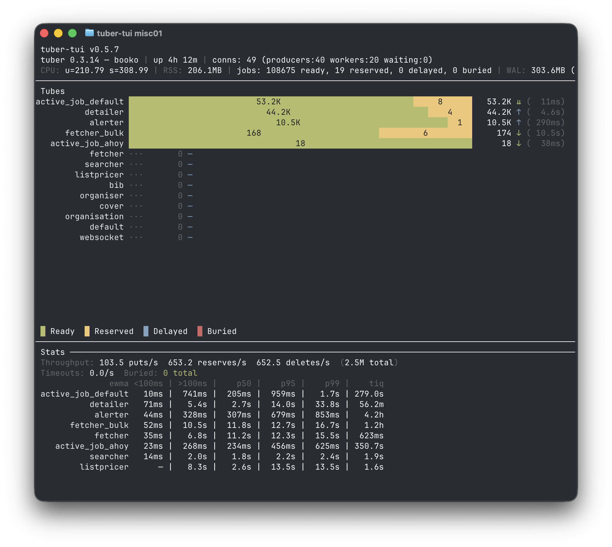

# tuber-rs

Rust client tools for [tuber](https://github.com/tuberq/tuber), a fast work queue server (beanstalkd-compatible).

This workspace contains three crates:

- **tuber-cli** — command-line client with JSON output, designed for scripting and AI agents
- **tuber-tui** — real-time terminal dashboard for monitoring queues
- **tuber-lib** — shared protocol client library (internal)

## tuber-cli

An agent-friendly CLI for interacting with tuber/beanstalkd queues. Outputs JSON by default.

### Install

```
brew install tuberq/tuber/tuber-cli
```

Or build from source:

```
cargo install --path tuber-cli
```

### Usage

```bash
# Server stats
tuber-cli stats

# List all tubes
tuber-cli list-tubes

# Tube stats
tuber-cli stats-tube emails

# Put a job
tuber-cli put --tube emails "send user@example.com"

# Put from stdin
echo '{"user": "alice"}' | tuber-cli put --tube notifications

# Tuber extensions: idempotent put, job groups, fan-in, concurrency limits
tuber-cli put --tube emails --idempotent welcome-42 "send welcome"
tuber-cli put --tube work --group batch-1 "shard 1"
tuber-cli put --tube work --after batch-1 "cleanup"
tuber-cli put --tube work --concurrency user-42 "resize avatar"

# Reserve a job
tuber-cli reserve --timeout 5

# Delete a job
tuber-cli delete 42

# Kick buried jobs (all, or one by ID)
tuber-cli kick 10 --tube emails
tuber-cli kick-job 42

# Peek at a job
tuber-cli peek 42

# Drain mode: reject new puts, let in-flight work finish
tuber-cli drain
tuber-cli undrain

# Text output instead of JSON
tuber-cli stats --format text
```

Note that a reservation belongs to the connection that made it, and each
`tuber-cli` run is a new connection. So `reserve` then `bury` as two commands
won't work — the reserve is dropped on exit. Use `tuber-lib` (or one `nc`
session) to reserve and finish a job together; see `skill/SKILL.md`.

### Options

| Option | Default | Description |
|---|---|---|
| `-a, --addr` | `$TUBER_ADDR` or `localhost:11300` | Server address |
| `-f, --format` | `json` | Output format: `json` or `text` |

## tuber-tui

A real-time terminal dashboard for monitoring tuber queues.



### Features

- Live server stats: version, uptime, connections, memory and disk headroom, drain status
- Per-tube job counts in fixed, colour-coded columns — ready, urgent, reserved, delayed, buried — beside a log-scaled bar sizing each tube against the busiest
- Throughput rates: puts/s, reserves/s, deletes/s, timeouts/s
- A detail pane for whichever tube the cursor is on: bimodal processing EWMA, percentiles, oldest job ages, bury rate, watcher counts
- Server totals as a footer row on the table, selectable like a tube to turn the pane over to the server
- Queue growth indicators
- Buried job highlighting
- Auto-reconnect on connection loss

### Install

```
brew install tuberq/tuber/tuber-tui
```

Or build from source:

```
cargo install --path tuber-tui
```

### Usage

```bash
tuber-tui                        # connects to TUBER_TUI or localhost:11300
tuber-tui staging.example.com    # custom host
tuber-tui :11301                 # custom port
tuber-tui -i 0.5                 # faster polling (0.5s)
```

| Option | Default | Description |
|---|---|---|
| `[HOST]` positional | `$TUBER_ADDR` or `localhost:11300` | Server address |
| `-i, --interval` | `1.5` | Poll interval (seconds) |

### Keys

| Key | Action |
|---|---|
| `↑` `↓` / `k` `j` | Move the cursor over the tubes, then the server row |
| `p` | Pause the selected tube — prompts for a duration |
| `u` | Unpause the selected tube immediately |
| `K` | Kick the selected tube — prompts for how many jobs |
| `s` | Cycle sort: by name (default), then by size |
| `e` | Show/hide empty tubes (no jobs in any state) |
| `q` | Quit |

Empty tubes are hidden on startup, since most tubes on a busy server are empty
most of the time. The title reports how many are out of view — ` Tubes (name ·
11 hidden) ` — and `e` brings them back.

Kick is `K` rather than `k`, which is already the vim-style cursor movement.
A single `kick` moves buried jobs whenever the tube has any, and only falls
through to delayed once there are none — one state per command, never both, so
a bound larger than the buried count does *not* spill into the delayed jobs.
The prompt therefore opens prefilled with everything one kick can move, and its
hint names the state as well as the number — ` = 42 buried` — so it is clear
which pile is about to move. Clearing a backlog is `K` then Enter; a smaller
bound is a matter of typing over the prefill. A tube with neither buried nor
delayed jobs refuses the prompt rather than opening one that could only report
`kicked 0`.

Pause durations are seconds by default, matching `tuber-cli pause --delay`.
`m` and `h` suffixes scale from there, so `90`, `5m` and `2h` are all valid, and
`0` unpauses. A paused tube carries a `PAUSED 12m` badge showing the time left,
and stays on screen even when it has drained and empty tubes are hidden — a
paused tube at zero is exactly the one you need to see.

### Layout

```
+------------------------------------------------------------------------+
| tuber-tui v0.13.0 - hetz01:11300                                       |
| tuber 0.13.0 - gr | up 41m | conns: 105 (producers:68 workers:35 ...)   |
| Mem: 77.7% (875.4MB / 1.1GB) | TOAST: 75% live | Disk: 57.1% (1.1/2.0G)|
+------------------------------------------------------------------------+
|              total     ready  urgnt  resvd  delay buried  size    ewma |
|     book    10.1K —     9.9K      ·      ·      ·    145  ███████░  9ms |
|   covers     1.6M ⇊     1.6M      ·    124     23      ·  ████████ 79ms |
|     work      907 ↓      109    780      4     14      ·  ████░░░░ 10ms |
|             ────────────────────────────────────────────               |
|▌   server     1.9M       1.9M    988    343     17   1.0K              |
+------------------------------------------------------------------------+
| Throughput: 0.2 puts/s  16.5 reserves/s  177.7 deletes/s  (2.2M total) |
| Timeouts: 0.0/s  Buried: 1043 total                                    |
| covers ----------------------------------------------------------------|
| jobs     1.6M ready · 124 delayed · 23 buried                          |
| runtime  79ms fast · 862ms slow · 100ms p50 · 1.3s p95 · 1.6s p99      |
| oldest   4m12s ready · 1m3s delayed · 2d3h buried                      |
| waiting  41.7m in queue · 8ms-4.2s over 1.2M runs · 0.02/s buried      |
| clients  3 using · 5 watching · 0 waiting · 1.2M reserves · 4 timeouts |
+------------------------------------------------------------------------+
```

Every job state has a fixed column, right-aligned and coloured, so a count can
be read down the screen as well as across — a state holding nothing shows a dim
`·` rather than closing the gap and shifting the columns after it. The header
labels are drawn in their state colours, so they double as the legend. A state
that neither any visible tube nor the server as a whole is using is dropped for
the whole frame, so alignment never costs width that is not carrying
information. The `urgnt` column above survives on the server's 988 alone —
every tube on screen shows a placeholder there, but the jobs exist in tubes the
filter is hiding, and a state with a total needs a column to put it in.

The bar sizes each tube against the busiest one on screen, log-scaled, so a tube
holding one job draws one cell and the lengths are comparable down the column.
Its fill is split linearly between the states, so the colours read as the real
mix — a handful of buried jobs in a large queue correctly claims no cell, and the
red count column is what makes it visible.

The `server` row carries the whole server's totals in those same columns. They
are the server's own figures rather than the sum of the rows above, which would
change as you scroll or as `e` hides and shows tubes. It takes the cursor like a
tube: select it and the pane below describes the server instead — rates, memory
and disk headroom, the WAL and TOAST counters, anything the server has had to
repair, and the fast/slow threshold the per-tube runtime line is measured
against. `p`, `u` and `K` have no tube to act on there and say so.

The pane's lines are in reading order, so a terminal too short for all of them
keeps the ones you would have read first and reports the rest in its heading.

The top bar keeps only what you would want to be interrupted by while watching
something else: which server, how long it has been up, who is connected, and how
much memory and disk is left. CPU, RSS, the WAL and TOAST breakdowns and the
server-wide job counts all moved to the `server` row and its pane, which is
where there is room for them.

The frame is titled with the address the client dialled. That is deliberate: the
`host` line in the server's pane is the server's *own* view of where it is
running — `hostname`, `os` and `platform` straight from `stats` — and inside a
container `hostname` is the container ID, so it identifies the container rather
than the machine. Set `--hostname` on the container, or give the server a `name`,
if you want that line to say something recognisable.

On a narrow terminal the bar gives way first, then the timing suffix, then the
name truncates.On a narrow terminal the bar gives way first, then the timing suffix, then the
name truncates. The counts and the total are the only numbers on a row that
appear nowhere else on screen, so they are never traded away.

## Requirements

- A running [tuber](https://github.com/tuberq/tuber) server (or any beanstalkd-compatible server)
- Rust 1.75+ (for building from source)

## License

MIT
